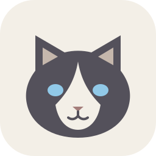

<p align="center">
  
</p>

<h1 align="center">Ragdoll</h1>

<p align="center">
  <strong>在 Mac 上整理、延续与归档你的 AI 编程会话。</strong>
</p>

<p align="center">
  
  
  
  <a href="https://github.com/OyamaMeek/Ragdoll/actions/workflows/release.yml"></a>
</p>

<p align="center">
  <a href="#功能">功能</a> ·
  <a href="#安装">安装</a> ·
  <a href="docs/USAGE.md">使用指南</a> ·
  <a href="docs/DEVELOPMENT.md">开发文档</a> ·
  <a href="https://github.com/OyamaMeek/Ragdoll/issues">反馈问题</a>
</p>

---

Ragdoll 是一款原生 SwiftUI macOS 应用，将 Codex、Claude Code 和 DeepSeek Harness 的本地历史集中到一个地方。搜索旧对话、查看 Token 活跃度与估算成本，或把历史迁移到另一个工具继续使用；会话还可以自动保存为 Markdown 和原始记录，归档到你选择的 Git 仓库。

## 功能

| 分类 | 功能 |
| --- | --- |
| 会话管理 | 读取多个工具的本地历史，按项目和来源筛选，搜索正文，分页浏览消息 |
| 原生对话 | 接入原生 Agent，创建或恢复会话，保留各工具自己的登录与会话记录 |
| 用量统计 | 年度 Token 热力图、历史年份切换、悬停查看用量、点击日期筛选会话，以及项目统计与估算成本 |
| 成本预算 | 可选的每周预算卡片，统计滚动 168 小时消费，在 80% 和 100% 时提醒 |
| 跨工具迁移 | 生成目标工具的原生历史，保留普通消息、不兼容记录全文、原始日志及可取得的附件 |
| Git 归档 | 自动保存完整会话快照、Markdown 与原始记录，本地提交，可选远端推送与失败重试 |
| Agent 与 ACP | 配置本地 ACP 命令，通过官方 Registry 安装、认证、更新与卸载 Agent |
| 后台服务 | 可选的用户级登录项，退出应用后继续扫描、归档与重试推送 |
| Claude 聊天导入 | 导入官方 ZIP 或 `conversations.json`，浏览历史并打开原聊天续聊 |

## 支持的来源

| 来源 | 历史接入 | 对话与迁移 |
| --- | --- | --- |
| Codex | 自动读取本地历史 | 原生续聊、迁移后的恢复与续聊已实测 |
| DeepSeek Harness | 自动读取本地历史 | 原生续聊、迁移后的恢复与续聊已实测 |
| Claude Code | 本地历史读取已实现 | 原生对话与迁移已实现，真实续聊及涉及 Claude 的迁移方向尚未验证 |
| ACP Agent | 通过本地命令或官方 Registry 接入 | 能力随 Agent 而异，dsh ACP 恢复与续聊已实测 |
| Claude 普通聊天 | 手动导入官方导出包 | 续聊打开原聊天，更新历史需重新导入；用户导出包实测尚未完成 |

## 安装

**系统要求：macOS 15 或更新版本，Apple Silicon。**

当前尚未发布正式 Release，请从源码构建。构建需要 Xcode 16.4+、Swift 6.1 和 Node 26。

```sh
git clone https://github.com/OyamaMeek/Ragdoll.git
cd Ragdoll
bash scripts/build.sh
open dist/Ragdoll.app
```

构建完成后，可将 `dist/Ragdoll.app` 移入“应用程序”。安装包内包含 Node 和 SDK 助手，运行打包后的应用无需另装 Node；首次构建会下载并校验 Node 官方发行包。

构建默认使用本地临时签名，未经 Apple 公证。首次打开可能受到 Gatekeeper 限制；独立后台服务需要有效 Apple 签名，详见[签名与后台服务](docs/DEVELOPMENT.md#签名与后台服务)。正式版本与构建记录见 [Releases](https://github.com/OyamaMeek/Ragdoll/releases) 和 [Actions](https://github.com/OyamaMeek/Ragdoll/actions/workflows/release.yml)。

## 开始使用

1. **选择归档仓库。** 首次启动时选择本地专用 Git 仓库，或选择空目录创建仓库；Git 需要配置 `user.name` 和 `user.email`。
2. **浏览本地会话。** 应用先读取归档，再扫描本机历史。在“会话”中筛选、搜索和打开记录，在首页查看年度热力图与项目用量。
3. **继续对话或迁移。** 在“对话”中选择项目与 Agent；需要跨工具使用旧历史时，进入“会话 → 迁移”。对应原生工具需要已经安装并登录。
4. **按需开启额外能力。** 在设置中启用每周预算、配置 ACP Agent、开启远端推送或独立后台服务。

具体操作与恢复说明见[使用指南](docs/USAGE.md)。

## 数据与隐私

- 数据与索引位于 `~/Library/Application Support/Ragdoll`，归档保存在你选择的 Git 仓库。
- 归档包含对话正文、工具输出和附件，可能含有敏感信息。**开启远端推送会上传该分支的完整 Git 历史，请先确认仓库可见性与已跟踪内容。** 应用不导出登录凭据，ACP 环境变量存入钥匙串。
- 推送失败时保留本地归档并支持重试；远端分歧需要手动处理，应用不自动拉取、合并或强制推送。
- 成本为估算值，缺失价格或用量时显示未知；ACP 的上下文占用量不计入消费 Token。

## 文档

- [使用指南](docs/USAGE.md)：来源目录、迁移、Git 归档、后台服务与使用限制。
- [开发文档](docs/DEVELOPMENT.md)：本地开发、检查命令、签名与自动发布。
- [验证记录](docs/VALIDATION.md)：实际测试结果及尚未完成的验证。
- [开发记录](docs/CHANGELOG.md) · [第三方参考与出处](docs/THIRD_PARTY.md)。
